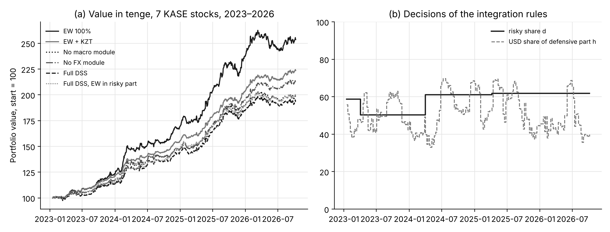
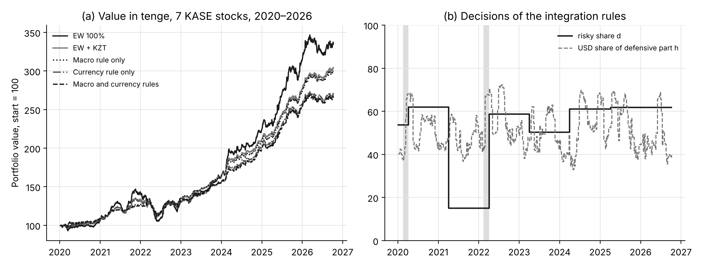

# Сквозная оценка СППР на данных KASE

Результаты `python scripts/end_to_end.py` (point-in-time бэктест интегрированной системы), `scripts/fx_returns.py` и `scripts/timing.py`; таблицы в `docs/results/e2e_*`, `fx_returns_*`, `timing.csv`. Числа этой страницы входят в статью о системе (таблицы 4–5).

## Протокол

На каждую дату недельной ребалансировки (первый торговый день недели) входы пересобираются из информации, доступной на эту дату:

* Модуль I переоценивается на панели ВВП, усечённой до последнего опубликованного года (рост за год Y считается известным с 1 апреля Y + 1; ряд Всемирного банка — текущий винтаж, поздние ревизии не удаляются);
* Модуль II — индекс валютного риска по курсам НБ РК до даты;
* Модуль III — K-medoids на скользящих 252 торговых днях;
* Модуль IV — ранговые сигналы walk-forward (ridge, random forest, gradient boosting; переобучение раз в 126 дней);
* интеграция — правила бюджета риска d и долларовой доли защитной части h, проверка совместимости лимитов профиля с кластерами (ослабление), веса рисковой части (max сигнал/риск, Ledoit–Wolf, 252 дня).

Учёт в тенге: веса, установленные на закрытии t, получают доходность t → t + 1; тенговая часть защитной компоненты начисляет базовую ставку НБ РК, долларовая — ставку 3-месячных казначейских векселей США (простое начисление, actual/365 по календарным дням) плюс изменение официального курса USD/KZT; издержки 10 б.п. с каждой стороны сделки (от суммы |Δw|). Оборот в таблицах — односторонний (половина суммы |Δw|), в долях портфеля. Доходности акций — по ценам закрытия KASE с учётом `data/corporate_actions.csv` (дивиденд KZTK 26 664,88 тг, май 2025 г.); `--no-corporate-actions` даёт ценовые доходности без поправки. Коэффициент Шарпа — по дневным доходностям сверх базовой ставки: (годовая геометрическая избыточная доходность)/(дневное ст. отклонение·√252). Разности Шарпа — парный циркулярный блочный бутстреп (2000 выборок, длина блока round(n^(1/3)), фиксированное зерно), p-значения без поправки и с поправкой Холма по пяти сравнениям с полной СППР.

## Таблица 4. Умеренный профиль, 7 бумаг KASE, 2023–2026

Период 2023-01-17 – 2026-10-09, 924 торговых дней, 195 ребалансировок, блок бутстрепа 10 дн., средняя базовая ставка 16.2%, IC ансамбля Модуля IV 0.018.

| Конфигурация | Доходность, % год. | Волатильность, % | Шарп | Макс. просадка, % | Оборот, раз/год | Средн. d, % | Средн. h, % | Разность Шарпа к «Full DSS» [95% ДИ] | p | p (Холм) |
|---|---|---|---|---|---|---|---|---|---|---|
| EW 100% | 28.9 | 9.1 | 1.01 | -7.6 | 0.7 | 100 | 0 | 0.80 [0.26; 1.40] | 0.004 | 0.020 |
| EW + KZT | 24.5 | 5.5 | 1.02 | -2.9 | 0.5 | 60 | 0 | 0.80 [0.28; 1.37] | 0.004 | 0.020 |
| No macro module | 20.5 | 7.1 | 0.31 | -4.5 | 6.2 | 60 | 51 | 0.10 [-0.01; 0.21] | 0.099 | 0.197 |
| No FX module | 22.9 | 6.5 | 0.64 | -3.4 | 5.3 | 58 | 0 | 0.43 [0.13; 0.72] | 0.006 | 0.020 |
| Full DSS | 19.7 | 6.9 | 0.21 | -4.7 | 6.0 | 58 | 51 | — | — | — |
| Full DSS, EW in risky part | 20.6 | 5.8 | 0.39 | -4.5 | 1.3 | 58 | 51 | 0.18 [-0.24; 0.62] | 0.419 | 0.419 |

Лимиты умеренного профиля (≤ 20% на актив, ≤ 50% на кластер) при k = 2 кластерах были ослаблены в 50% решений (до ≤ 30% / ≤ 70%).

### Проверки устойчивости (та же схема)

**Ценовые доходности без поправки на дивиденд KZTK (`--no-corporate-actions`)** — 2023-01-17 – 2026-10-09, 924 дн.: EW 100% 0.78 (доходность 26.4%, просадка -7.6%); EW + KZT 0.79 (доходность 23.1%, просадка -3.4%); No macro module 0.12 (доходность 19.0%, просадка -5.8%); No FX module 0.42 (доходность 21.2%, просадка -5.8%); Full DSS 0.02 (доходность 18.1%, просадка -6.0%); Full DSS, EW in risky part 0.18 (доходность 19.2%, просадка -4.5%).

**Без KZTK (6 бумаг)** — 2023-01-17 – 2026-10-09, 924 дн.: EW 100% 0.85 (доходность 27.8%, просадка -7.5%); EW + KZT 0.86 (доходность 23.9%, просадка -3.3%); No macro module 0.23 (доходность 20.0%, просадка -5.1%); No FX module 0.51 (доходность 22.0%, просадка -3.5%); Full DSS 0.11 (доходность 18.8%, просадка -5.3%); Full DSS, EW in risky part 0.27 (доходность 19.9%, просадка -4.4%).

**Все 9 бумаг KASE, с 23.12.2024** — 2024-12-24 – 2026-10-09, 442 дн.: EW 100% 0.64 (доходность 26.0%, просадка -6.4%); EW + KZT 0.65 (доходность 23.3%, просадка -2.9%); No macro module 0.04 (доходность 19.2%, просадка -4.8%); No FX module 0.81 (доходность 25.0%, просадка -3.6%); Full DSS 0.09 (доходность 19.6%, просадка -4.8%); Full DSS, EW in risky part -0.11 (доходность 18.1%, просадка -4.5%).

**Проверка на утечку будущего** (`--perturb 2025-01-01`): цены, курсы с 2025-01-01 и последний год ВВП заменены случайными числами; 103 из 103 недельных решений полной СППР до этой даты совпали с исходными с точностью 1e-10.

### Чувствительность коэффициентов правил интеграции (полная СППР)

| Вариант | Шарп | Макс. просадка, % | Доходность, % | Средн. d, % | Средн. h, % |
|---|---|---|---|---|---|
| baseline | 0.21 | -4.7 | 19.7 | 58 | 51 |
| rec_penalty x0.75 | 0.23 | -4.7 | 19.8 | 59 | 51 |
| rec_penalty x1.25 | 0.20 | -4.6 | 19.5 | 58 | 51 |
| neg_growth_cut x0.75 | 0.21 | -4.7 | 19.7 | 58 | 51 |
| neg_growth_cut x1.25 | 0.21 | -4.7 | 19.7 | 58 | 51 |
| hedge_base x0.75 | 0.24 | -4.5 | 19.9 | 58 | 47 |
| hedge_base x1.25 | 0.18 | -4.8 | 19.4 | 58 | 55 |
| hedge_slope x0.75 | 0.29 | -4.3 | 20.2 | 58 | 42 |
| hedge_slope x1.25 | 0.14 | -5.0 | 19.1 | 58 | 60 |
| hedge_max x0.75 | 0.23 | -4.6 | 19.8 | 58 | 50 |
| hedge_max x1.25 | 0.21 | -4.7 | 19.7 | 58 | 51 |
| scenario_mult x0.75 | -0.08 | -4.0 | 17.4 | 44 | 51 |
| phase_mult x0.75 | -0.08 | -4.0 | 17.4 | 44 | 51 |
| scenario_mult x1.25 | 0.41 | -5.9 | 22.0 | 73 | 51 |
| phase_mult x1.25 | 0.41 | -5.9 | 22.0 | 73 | 51 |
| phase_mult removed | 0.25 | -4.4 | 19.9 | 57 | 51 |
| fx weights equal | 0.21 | -4.6 | 19.7 | 58 | 50 |

Множители сценария и фазы входят в правило (5) одинаково (произведение), поэтому их варианты ×0,75 и ×1,25 совпадают.

### Доходность защитной части: доступные ставки ниже базовой и издержки выше 10 б.п. (точный перерасчёт, те же решения)

| Конфигурация | KZT yield -0%, costs 10 b.p. | KZT yield -2%, costs 10 b.p. | KZT yield -4%, costs 10 b.p. | KZT yield -0%, costs 30 b.p. | KZT yield -4%, costs 30 b.p. |
|---|---|---|---|---|---|
| EW + KZT | 1.02 | 0.86 | 0.70 | 0.98 | 0.67 |
| EW 100% | 1.01 | 1.01 | 1.01 | 0.98 | 0.98 |
| Full DSS | 0.21 | 0.15 | 0.09 | -0.14 | -0.26 |
| Full DSS, EW in risky part | 0.39 | 0.32 | 0.25 | 0.30 | 0.16 |
| No FX module | 0.64 | 0.51 | 0.37 | 0.31 | 0.04 |
| No macro module | 0.31 | 0.25 | 0.19 | -0.04 | -0.16 |

Шарп по-прежнему измеряется сверх базовой ставки. Снижение доходности тенговой части на 2 и 4 п.п. означает ставку депозита ниже базовой; 30 б.п. — издержки с каждой стороны сделки.

## Таблица 5. Модули I–II с равными весами в рисковой части, 7 бумаг KASE, 2020–2026

Период 2020-01-08 – 2026-10-09, 1670 торговых дней, 353 ребалансировок, блок бутстрепа 12 дн., средняя базовая ставка 13.9%.

| Конфигурация | Доходность, % год. | Волатильность, % | Шарп | Макс. просадка, % | Оборот, раз/год | Средн. d, % | Средн. h, % || Доходность 20.02–31.03.2020, % | 15.02–31.03.2022, % | Разность Шарпа к «EW + KZT» [95% ДИ] | p | p (Холм) |
|---|---|---|---|---|---|---|---|---|---|---|---|---|---|
| EW 100% | 20.0 | 10.6 | 0.39 | -28.4 | 0.7 | 100 | 0 | -1.8 | -5.1 | -0.02 [-0.03; 0.02] | 0.087 | 0.292 |
| EW + KZT | 18.2 | 6.3 | 0.41 | -15.9 | 0.5 | 60 | 0 | -0.6 | -2.4 | — | — | — |
| Macro rule only | 18.0 | 5.4 | 0.45 | -10.8 | 0.6 | 52 | 0 | -0.4 | 0.6 | 0.03 [-0.34; 0.39] | 0.860 | 0.860 |
| Currency rule only | 16.1 | 6.9 | 0.12 | -17.9 | 1.1 | 60 | 51 | 3.5 | -1.7 | -0.30 [-0.61; 0.06] | 0.073 | 0.292 |
| Macro and currency rules | 15.9 | 6.4 | 0.10 | -17.6 | 1.3 | 52 | 51 | 4.4 | 2.0 | -0.32 [-0.96; 0.39] | 0.348 | 0.696 |

Рецессия 2020 г. попала в данные ВВП в апреле 2021 г.: с 05.04.2021 по 28.03.2022 P(рецессии) = 0.92, фаза «Спад», прогноз роста -6.2% → доля рисковых активов 15% вместо 60%. На шок марта 2020 г. правило не отреагировало (рецессия ещё не наблюдалась).

## Валютный риск на доходностях (`scripts/fx_returns.py`)

| Период | Пара | Корреляция уровней | Корреляция дневных лог-доходностей |
|---|---|---|---|
| 2000-2024 | USD-EUR | 0.98 | 0.73 |
| 2000-2024 | USD-CNY | 0.99 | 0.97 |
| 2000-2024 | USD-RUB | 0.62 | 0.44 |
| 2000-2024 | EUR-CNY | 0.99 | 0.75 |
| 2000-2024 | EUR-RUB | 0.60 | 0.47 |
| 2000-2024 | CNY-RUB | 0.60 | 0.47 |
| after float (2015-08-20 - 2024) | USD-EUR | 0.94 | 0.89 |
| after float (2015-08-20 - 2024) | USD-CNY | 0.95 | 0.96 |
| after float (2015-08-20 - 2024) | USD-RUB | 0.34 | 0.45 |
| after float (2015-08-20 - 2024) | EUR-CNY | 0.95 | 0.92 |
| after float (2015-08-20 - 2024) | EUR-RUB | 0.26 | 0.45 |
| after float (2015-08-20 - 2024) | CNY-RUB | 0.36 | 0.47 |

* 2000-2024: PC1 объясняет 99% дисперсии уровней USD, EUR, CNY и 88% дисперсии их доходностей (5536 дней с изменением курса).
* after float (2015-08-20 - 2024): PC1 объясняет 97% дисперсии уровней USD, EUR, CNY и 95% дисперсии их доходностей (2279 дней с изменением курса).
* Недельные доходности равновзвешенного портфеля бумаг KASE и изменения USD/KZT, 2019-01-11 – 2026-10-09 (405 недель): корреляция Пирсона -0.04, Спирмена 0.03; дневная 0.07. Долларовая позиция не хеджирует тенговый риск акций.

## Производительность (`scripts/timing.py`)

Linux-6.18.44-fc-v185-x86_64-with-glibc2.39, Python 3.13.17, один процесс; Intel Xeon 2,8 ГГц (контейнер).

| Операция | Время, с (медиана) | Повторов | Примечание |
|---|---|---|---|
| Module I: macro.run (full GDP panel) | 22.07 | 5 | 214 economies |
| Module IV: signals.run, KASE, 3 models (ridge, rf, gb) | 3.81 | 3 | 9 stocks |
| Module IV: signals.run, KASE, 8 scikit-learn models | 16.71 | 3 | 9 stocks |
| Module IV: signals.run, NSE, 3 models (ridge, rf, gb) | 10.89 | 3 | 20 stocks |
| pipeline.run, cold cache (all modules and the Module IV backtest) | 32.29 | 1 |  |
| pipeline.run, warm cache (recommendation for cached settings) | 0.08 | 5 |  |
| integration.decide alone | 0.03 | 5 |  |
| change of investor profile, decision only | 0.07 | 1 | Modules I-IV reused from the cache |
| change of investor profile, with the Module IV backtest | 4.52 | 1 | backtest recomputed for the new limits |
| same profile change, cached | 0.11 | 5 |  |
