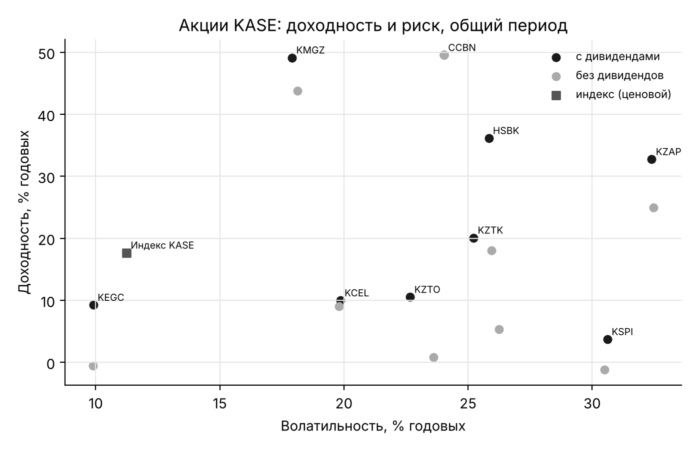

# Профиль рынка KASE: доходность – риск – ликвидность

Результаты `python scripts/kase_profile.py`; таблицы `docs/results/kase_profile.csv`, `kase_profile_bonds.csv`, график `kase_profile.png`. Шарп — по дневным доходностям сверх базовой ставки НБ РК, как в статье; «без сделок» — доля торговых дней биржи (дни индекса KASE или любой бумаги) без цены бумаги, остальные показатели — по дням со сделками; Амихуд — mean(|r|/оборот)·10⁹ по дням со сделками (оборот в тенге); «без изменения цены» — доля дней с нулевой доходностью; корреляция — недельных доходностей с курсом USD/KZT (положительная: бумага дорожает в тенге при ослаблении тенге).

## Акции, вся история

| Бумага | Дивиденды | Период | Доходность, % | Волатильность, % | Макс. просадка, % | Шарп | Без изменения цены, % | Без сделок, % | Амихуд | Корр. с USD/KZT |
|---|---|---|---|---|---|---|---|---|---|---|
| CCBN | без дивидендов | 2008-01-03 – 2026-11-11 | 9,4% | 63,8% | -92,9% | -0,06 | 9,5% | 15,7% | 952,200 | -0,09 |
| CCBN | с дивидендами | 2008-01-03 – 2026-11-11 | 9,4% | 63,8% | -92,9% | -0,06 | 9,5% | 15,7% | 952,200 | -0,09 |
| HSBK | без дивидендов | 2008-01-04 – 2026-11-11 | -1,6% | 48,1% | -95,3% | -0,25 | 5,7% | 4,7% | 107,168 | 0,04 |
| HSBK | с дивидендами | 2008-01-04 – 2026-11-11 | 20,9% | 43,1% | -88,6% | 0,19 | 5,7% | 4,7% | 107,050 | 0,04 |
| KCEL | без дивидендов | 2012-12-13 – 2026-11-11 | 4,6% | 26,9% | -67,5% | -0,27 | 7,8% | 3,8% | 44,816 | 0,14 |
| KCEL | с дивидендами | 2012-12-13 – 2026-11-11 | 9,8% | 26,8% | -65,6% | -0,10 | 7,8% | 3,8% | 44,824 | 0,14 |
| KEGC | без дивидендов | 2014-12-19 – 2026-11-11 | 9,6% | 18,7% | -35,8% | -0,19 | 5,9% | 0,2% | 1,227 | -0,07 |
| KEGC | с дивидендами | 2014-12-19 – 2026-11-11 | 19,3% | 18,6% | -35,8% | 0,28 | 5,9% | 0,2% | 1,222 | -0,07 |
| KMGZ | без дивидендов | 2022-12-08 – 2026-11-11 | 43,8% | 18,1% | -16,7% | 1,20 | 2,4% | 0,0% | 0,102 | -0,04 |
| KMGZ | с дивидендами | 2022-12-08 – 2026-11-11 | 49,1% | 17,9% | -16,7% | 1,47 | 2,4% | 0,0% | 0,101 | -0,03 |
| KSPI | без дивидендов | 2018-07-23 – 2026-11-11 | 52,0% | 348,3% | -66,6% | 0,09 | 1,4% | 35,5% | 13,761 | -0,17 |
| KSPI | с дивидендами | 2018-07-23 – 2026-11-11 | 61,8% | 379,0% | -66,3% | 0,10 | 1,4% | 35,5% | 14,913 | -0,17 |
| KZAP | без дивидендов | 2018-12-11 – 2026-11-11 | 25,0% | 32,5% | -44,9% | 0,28 | 3,2% | 1,3% | 11,335 | 0,06 |
| KZAP | с дивидендами | 2018-12-11 – 2026-11-11 | 32,7% | 32,4% | -44,9% | 0,49 | 3,2% | 1,3% | 11,324 | 0,07 |
| KZTK | без дивидендов | 2008-01-03 – 2026-11-11 | 1,2% | 45,4% | -87,5% | -0,22 | 9,4% | 7,6% | 16,817 | -0,04 |
| KZTK | с дивидендами | 2008-01-03 – 2026-11-11 | 16,8% | 42,8% | -87,3% | 0,09 | 9,4% | 7,6% | 16,620 | -0,05 |
| KZTO | без дивидендов | 2012-12-25 – 2026-11-11 | 3,9% | 25,5% | -66,6% | -0,29 | 4,7% | 0,2% | 0,681 | -0,03 |
| KZTO | с дивидендами | 2012-12-25 – 2026-11-11 | 15,3% | 24,2% | -53,3% | 0,11 | 4,8% | 0,2% | 0,678 | -0,04 |
| Индекс KASE | индекс (ценовой) | 2008-01-03 – 2026-11-11 | 6,1% | 22,5% | -79,8% | -0,21 | 0,1% | — | 0,136 | 0,13 |

## Акции, общий период KASE7 (с 11.12.2018)

| Бумага | Дивиденды | Период | Доходность, % | Волатильность, % | Макс. просадка, % | Шарп | Без изменения цены, % | Без сделок, % | Амихуд | Корр. с USD/KZT |
|---|---|---|---|---|---|---|---|---|---|---|
| CCBN | без дивидендов | 2018-12-11 – 2026-11-11 | 49,5% | 24,0% | -22,5% | 1,27 | 7,3% | 0,7% | 158,276 | 0,04 |
| CCBN | с дивидендами | 2018-12-11 – 2026-11-11 | 49,5% | 24,0% | -22,5% | 1,27 | 7,3% | 0,7% | 158,276 | 0,04 |
| HSBK | без дивидендов | 2018-12-11 – 2026-11-11 | 18,0% | 26,0% | -48,0% | 0,12 | 2,2% | 0,2% | 0,900 | -0,10 |
| HSBK | с дивидендами | 2018-12-11 – 2026-11-11 | 36,1% | 25,8% | -48,0% | 0,73 | 2,2% | 0,2% | 0,900 | -0,10 |
| KCEL | без дивидендов | 2018-12-11 – 2026-11-11 | 9,0% | 19,8% | -66,7% | -0,24 | 7,3% | 0,3% | 15,744 | 0,11 |
| KCEL | с дивидендами | 2018-12-11 – 2026-11-11 | 10,0% | 19,9% | -65,6% | -0,20 | 7,2% | 0,3% | 15,754 | 0,11 |
| KEGC | без дивидендов | 2018-12-11 – 2026-11-11 | -0,5% | 9,9% | -29,1% | -1,32 | 6,3% | 0,2% | 1,310 | 0,05 |
| KEGC | с дивидендами | 2018-12-11 – 2026-11-11 | 9,2% | 9,9% | -15,8% | -0,46 | 6,3% | 0,2% | 1,318 | 0,07 |
| KMGZ | без дивидендов | 2022-12-08 – 2026-11-11 | 43,8% | 18,1% | -16,7% | 1,20 | 2,4% | 0,0% | 0,102 | -0,04 |
| KMGZ | с дивидендами | 2022-12-08 – 2026-11-11 | 49,1% | 17,9% | -16,7% | 1,47 | 2,4% | 0,0% | 0,101 | -0,03 |
| KSPI | без дивидендов | 2021-07-15 – 2026-11-11 | -1,2% | 30,5% | -66,6% | -0,50 | 1,1% | 0,1% | 0,929 | -0,17 |
| KSPI | с дивидендами | 2021-07-15 – 2026-11-11 | 3,7% | 30,6% | -66,3% | -0,37 | 1,1% | 0,1% | 0,943 | -0,17 |
| KZAP | без дивидендов | 2018-12-11 – 2026-11-11 | 25,0% | 32,5% | -44,9% | 0,28 | 3,2% | 1,3% | 11,335 | 0,06 |
| KZAP | с дивидендами | 2018-12-11 – 2026-11-11 | 32,7% | 32,4% | -44,9% | 0,49 | 3,2% | 1,3% | 11,324 | 0,07 |
| KZTK | без дивидендов | 2018-12-11 – 2026-11-11 | 5,3% | 26,2% | -42,3% | -0,31 | 4,2% | 0,3% | 3,790 | 0,01 |
| KZTK | с дивидендами | 2018-12-11 – 2026-11-11 | 20,1% | 25,2% | -33,7% | 0,19 | 4,2% | 0,3% | 3,789 | -0,02 |
| KZTO | без дивидендов | 2018-12-11 – 2026-11-11 | 0,8% | 23,6% | -62,3% | -0,51 | 2,7% | 0,1% | 0,780 | -0,11 |
| KZTO | с дивидендами | 2018-12-11 – 2026-11-11 | 10,5% | 22,7% | -53,3% | -0,15 | 2,7% | 0,1% | 0,778 | -0,14 |
| Индекс KASE | индекс (ценовой) | 2018-12-11 – 2026-11-11 | 17,7% | 11,2% | -31,3% | 0,24 | 0,1% | — | 0,030 | -0,01 |

## Облигации

Индексы (KZGB_DP — «грязная» цена ГЦБ, KZGB_CP — чистая цена ГЦБ, KASE_BMC — корпоративные облигации). Это ценовые индексы без реинвестирования купонов, поэтому их доходность и Шарп занижены и с акциями не сравнимы; они показывают только колебания цен:

| Индекс | Период | Доходность, % | Волатильность, % | Макс. просадка, % | Шарп | Корр. с USD/KZT |
|---|---|---|---|---|---|---|
| KZGB_DP | 2023-10-02 – 2026-11-11 | 8,3% | 6,9% | -11,3% | -1,19 | -0,09 |
| KZGB_CP | 2023-10-02 – 2026-11-11 | 0,2% | 7,1% | -16,2% | -2,12 | -0,08 |
| KASE_BMC | 2017-09-04 – 2026-11-11 | -0,1% | 2,7% | -7,8% | -4,44 | -0,03 |

Отдельные выпуски: по ним нет непрерывного ряда цен, поэтому показаны только число дней со сделками и доля торговых дней биржи без сделок между первой и последней сделкой.

| Выпуск | Тип | Валюта | Период | Дней со сделками | Без сделок, % |
|---|---|---|---|---|---|
| MUM120_0001 | МЕУКАМ | KZT | 2008-01-18 – 2014-12-11 | 100 | 94,1% |
| MUM180_0001 | МЕУКАМ | KZT | 2009-05-21 – 2024-03-13 | 96 | 97,4% |
| MUM240_0001 | МЕУКАМ | KZT | 2012-04-28 – 2026-11-11 | 246 | 93,2% |
| MUM120_0017 | МЕУКАМ | KZT | 2017-10-26 – 2026-09-28 | 224 | 89,8% |
| MUM180_0011 | МЕУКАМ | KZT | 2017-09-06 – 2026-11-09 | 315 | 86,1% |
| MUM168_0003 | МЕУКАМ | KZT | 2018-10-15 – 2026-11-09 | 383 | 80,8% |
| KZ_05_2410 | еврооблигации | USD | 2014-12-05 – 2024-09-30 | 152 | 93,8% |
| KZ_06_4410 | еврооблигации | USD | 2014-11-20 – 2026-11-02 | 363 | 87,7% |
| HSBKb10 | субординированные купонные облигации | KZT | 2008-08-20 – 2015-09-15 | 87 | 95,0% |
| KKGBb4 | субординированные купонные облигации | KZT | 2008-06-20 – 2014-11-25 | 80 | 94,9% |
| KEGCb3 | купонные облигации | KZT | 2021-02-08 – 2026-11-11 | 178 | 87,5% |
| KMGZe11 | купонные международные облигации | USD | 2019-10-11 – 2026-11-09 | 79 | 95,5% |

## Выводы

* В общем периоде (с 11.12.2018) Шарп акций с дивидендами — от -0,46 до 1,47; доля дней без изменения цены — от 1,1% до 7,3%.
* Облигационный рынок KASE для бэктеста защитной части по отдельным выпускам непригоден: у выпусков десятки–сотни дней со сделками за всю историю. Поэтому тенговая часть в СППР моделируется базовой ставкой НБ РК (с проверкой чувствительности к её снижению), а индексы ГЦБ — только для сравнения.

