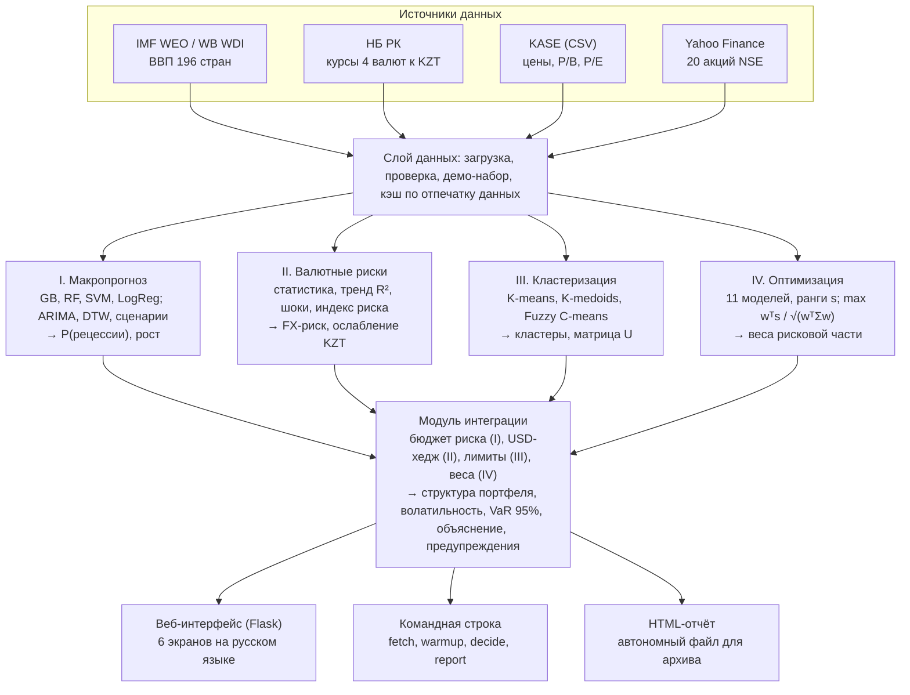
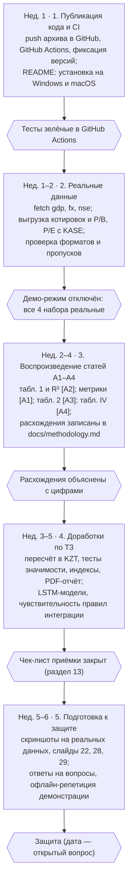

# Техническое задание на разработку СППР управления инвестиционным портфелем (phd-dss)

Версия от 08.10.2026 · Дурбенов Р.М.

## Содержание

1. [Общие сведения](#1-общие-сведения)
2. [Назначение и цели системы](#2-назначение-и-цели-системы)
3. [Пользователи и сценарии использования](#3-пользователи-и-сценарии-использования)
4. [Архитектура системы](#4-архитектура-системы)
5. [Требования к данным и источникам](#5-требования-к-данным-и-источникам)
6. [Модуль I — макропрогноз](#6-функциональные-требования-модуль-i--макропрогноз-a1)
7. [Модуль II — валютные риски тенге](#7-модуль-ii--валютные-риски-тенге-a2)
8. [Модуль III — кластеризация активов](#8-модуль-iii--кластеризация-активов-a3)
9. [Модуль IV — ранговые сигналы и оптимизация](#9-модуль-iv--ранговые-сигналы-и-оптимизация-портфеля-a4)
10. [Модуль интеграции и правила принятия решения](#10-модуль-интеграции-и-правила-принятия-решения)
11. [Пользовательский интерфейс, CLI, отчёт](#11-пользовательский-интерфейс-cli-отчёт)
12. [Нефункциональные требования](#12-нефункциональные-требования)
13. [Структура кода, тестирование и приёмка](#13-структура-кода-тестирование-и-приёмка)
14. [Этапы работ и сроки](#14-этапы-работ-и-сроки)
15. [Риски и известные расхождения в опубликованных статьях](#15-риски-и-известные-расхождения-в-опубликованных-статьях)

## 1. Общие сведения

Система phd-dss — программная реализация диссертации Р.М. Дурбенова; её версия 1.0 должна быть готова, протестирована на реальных данных и опубликована в репозитории до защиты.

| Параметр             | Значение                                                                                           |
| -------------------- | -------------------------------------------------------------------------------------------------- |
| Полное наименование  | Система поддержки принятия решений (СППР) при управлении инвестиционным портфелем                  |
| Краткое наименование | phd-dss                                                                                            |
| Основание            | Диссертация на соискание степени PhD по ОП 8D06103 «Информационные системы», ЕНУ им. Л.Н. Гумилёва |
| Разработчик          | Дурбенов Р.М. (докторант)                                                                          |
| Научные консультанты | Ламашева Ж.Б. (ЕНУ), Лахно В.А. (НУБиП Украины)                                                    |
| Внедрение            | ТОО «Dvasoroksem Group» (МФЦА), акт внедрения                                                      |
| Репозиторий          | [github.com/programmankz/phd-dss](https://github.com/programmankz/phd-dss)                         |
| Лицензия             | Определяет разработчик (рекомендуется MIT)                                                         |

**Научная основа.** Каждый модуль системы реализует методику одной статьи:

| Код  | Статья                                                                                                                                     | Модуль             |
| ---- | ------------------------------------------------------------------------------------------------------------------------------------------ | ------------------ |
| [A1] | GDP Growth Forecasting Using Machine Learning: Global Evidence with a Kazakhstan Case Study. IJIES, 2026, 19(6), 626–648                   | I. Макропрогноз    |
| [A2] | Exchange rate dynamics of USD-KZT, EUR-KZT, RUB-KZT and CNY-KZT (2000–2024). Вестник НИА РК, 2025, № 2 (96)                                | II. Валютные риски |
| [A3] | Clustering in compiling investment portfolios. Вестник КазАТК, 2024, № 3 (132), 206–215                                                    | III. Кластеризация |
| [A4] | Machine Learning-Based Portfolio Optimization Using Cross-Sectional Signals: Evidence from the NSE Market. ETASR, 2026, 16(4), 37880–37888 | IV. Оптимизация    |

**Текущее состояние.** Прототип версии 1.0 разработан и передан архивом phd-dss.zip: код всех модулей, веб-интерфейс, 13 тестов, один коммит с настроенным remote. Репозиторий на GitHub пока пуст — первый шаг работ по этому ТЗ (раздел 14) — отправить в него прототип.

## 2. Назначение и цели системы

Система выдаёт обоснованную рекомендацию о структуре инвестиционного портфеля казахстанского инвестора: долю рисковых активов, валютный хедж и веса бумаг, с объяснением вклада каждого модуля.

**Назначение:**

- поддержка решений аналитиков и управляющих активами при формировании и ребалансировке портфеля;
- мониторинг риска рецессии и валютного риска тенге для регуляторов, ЕНПФ и экспортёров;
- сценарный анализ Base / Bull / Bear / Stress для планирования;
- демонстрация и проверка научных результатов диссертации.

**Цели и критерии их достижения:**

| Цель                                                 | Критерий достижения                                                                                                     |
| ---------------------------------------------------- | ----------------------------------------------------------------------------------------------------------------------- |
| Объединить четыре модуля в единый конвейер           | Одно действие пользователя запускает модули I–IV и интеграцию; результат — рекомендация с объяснением по каждому модулю |
| Воспроизвести методики статей [A1]–[A4]              | Каждый метод статьи реализован с параметрами из статьи; расхождения задокументированы в docs/methodology.md             |
| Подтвердить работу на реальных данных                | Полный расчёт на данных IMF, НБ РК, KASE и NSE без ошибок; таблица 2 [A3] заполнена числами                             |
| Исключить заглядывание вперёд                        | Все признаки и бэктесты строго вне выборки; подтверждается автотестами                                                  |
| Обеспечить воспроизводимость                         | Фиксированный seed 42, версии зависимостей зафиксированы, повторный запуск даёт те же числа                             |
| Сделать систему пригодной для демонстрации на защите | Веб-интерфейс открывается за ≤ 3 с после прогрева кэша; есть офлайн-режим                                               |

**Вне рамок версии 1.0:** исполнение сделок и подключение к брокерам, работа с персональными данными инвесторов, многопользовательский режим с разграничением прав, прогнозы в реальном времени внутри дня. Система носит аналитический характер и не является индивидуальной инвестиционной рекомендацией.

## 3. Пользователи и сценарии использования

Основной пользователь — инвестиционный аналитик; остальные роли используют те же экраны в режиме просмотра.

| Роль                         | Что делает в системе                                                | Ключевые экраны              |
| ---------------------------- | ------------------------------------------------------------------- | ---------------------------- |
| Инвестиционный аналитик      | Выбирает профиль и сценарий, получает рекомендацию, выгружает отчёт | Решение, Сигналы, Отчёт      |
| Управляющий активами         | Проверяет обоснование решения и ограничения риска                   | Решение, Кластеризация       |
| Риск-менеджер / регулятор    | Следит за вероятностью рецессии и валютным риском                   | Макропрогноз, Валютные риски |
| Исследователь (докторант)    | Воспроизводит эксперименты статей, меняет модели и параметры        | Все экраны, CLI              |
| Член диссертационного совета | Смотрит демонстрацию на защите                                      | Решение, экраны модулей      |

**Сценарии использования:**

1. **Получить рекомендацию.** Пользователь выбирает профиль (консервативный / умеренный / агрессивный) и сценарий, нажимает «Пересчитать». Система показывает цепочку I → IV, итоговую структуру портфеля, ожидаемую волатильность и VaR 95% за месяц.
2. **Сравнить сценарии.** Пользователь переключает сценарий Base → Stress и видит, как меняются доля рисковых активов и веса.
3. **Анализ чувствительности.** На экране «Макропрогноз» пользователь задаёт цену Brent, срок сбоя КТК, ставку, рост ВВП Китая, ослабление тенге и получает эффект на рост ВВП следующего года.
4. **Обновить данные.** Пользователь загружает данные командами fetch или кладёт CSV в папку data/, сбрасывает кэш; система помечает источник каждого набора.
5. **Сформировать отчёт.** Пользователь скачивает автономный HTML-отчёт с решением, графиками и таблицами всех модулей.
6. **Воспроизвести эксперимент статьи.** Исследователь запускает модуль с параметрами статьи (например, выборочная ковариация и ежедневная ребалансировка для [A4]) и сравнивает результат с опубликованным.

## 4. Архитектура системы

Система построена как последовательный конвейер: каждый модуль работает на своих данных и передаёт в модуль интеграции один сигнал; интерфейсы только показывают результат и не содержат расчётов.

Модули связаны только через объекты результатов, поэтому любой из них можно заменить или переобучить, не трогая остальные; смена профиля или сценария пересчитывает только модуль интеграции.

**Технологический стек:** Python ≥ 3.10; NumPy, pandas; scikit-learn (модели, метрики); SciPy (SLSQP, статистика); matplotlib (графики); Flask и Jinja2 (интерфейс); pickle-кэш на диске. Опционально: statsmodels (точная оценка ARIMA), yfinance (NSE), TensorFlow / Keras (RNN, LSTM, CNN-LSTM, LSTM-MLP), Playwright (скриншоты).

## 5. Требования к данным и источникам

Система работает с четырьмя наборами данных; для каждого есть реальный источник и синтетический демо-набор, который используется только при отсутствии реальных данных.

| Файл в data/          | Содержание и формат                          | Источник                                       | Объём (ориентир)      | Модуль  |
| --------------------- | -------------------------------------------- | ---------------------------------------------- | --------------------- | ------- |
| gdp_growth.csv        | country, 1980 … 2024 — рост реального ВВП, % | IMF WEO DataMapper (NGDP_RPCH); World Bank WDI | 196 стран × 45 лет    | I       |
| fx_rates.csv          | Date, USD, EUR, CNY, RUB — тенге за единицу  | Официальные курсы НБ РК (nationalbank.kz)      | 9 086 дней, 2000–2024 | II      |
| prices_kase.csv       | Date, тикер1, тикер2 … — цены закрытия       | Выгрузка kase.kz                               | ≥ 10 бумаг, ≥ 3 лет   | III, IV |
| fundamentals_kase.csv | ticker, sector, PB, PE                       | kase.kz, отчётность эмитентов                  | по числу бумаг        | III     |
| prices_nse.csv        | Date, HDFCBANK.NS … — цены закрытия          | Yahoo Finance (yfinance)                       | 20 акций, 2020–2025   | III, IV |

**Требования:**

1. Загрузка реальных данных командами `python -m dss.cli fetch gdp | fx | nse`; загрузка курсов НБ РК — с докачкой с последней сохранённой даты.
2. Пользовательские CSV в папке data/ (или DSS_DATA_DIR) имеют приоритет над сетевыми источниками и демо-набором.
3. Пропуски: в панели ВВП строки с пропусками исключаются (как в [A1]); в ценах — перенос последнего значения вперёд; в макропеременных — медиана внутри группы доходов IMF.
4. Каждый экран и отчёт показывает источник каждого набора; при использовании синтетики выводится плашка «Демо-режим».
5. Демо-набор детерминирован (seed 42) и по форме похож на реальные ряды, но запрещено использовать его результаты как эмпирические выводы.
6. Открытый вопрос: у KASE нет публичного API — порядок регулярного получения котировок (ручная выгрузка, подписка на данные KASE) определяет разработчик.

## 6. Функциональные требования: Модуль I — макропрогноз [A1]

Модуль I оценивает фазу экономического цикла, вероятность рецессии и путь роста ВВП Казахстана на 2025–2029 гг. и передаёт их в модуль интеграции как основу бюджета риска.

| ID      | Требование                               | Параметры и критерий                                                                                                                                                      | Статус v1.0                                                                                           |
| ------- | ---------------------------------------- | ------------------------------------------------------------------------------------------------------------------------------------------------------------------------- | ----------------------------------------------------------------------------------------------------- |
| ФТ-I-01 | Построение признаков по каждой стране    | lag1–3, rolling_mean3/5, rolling_std3, cumulative_mean, year_norm; только значения до года t (Прил. A.1 [A1])                                                             | Реализовано, тест                                                                                     |
| ФТ-I-02 | Хронологический сплит                    | Обучение ≤ 2014, тест 2015–2024; StandardScaler обучается только на train                                                                                                 | Реализовано                                                                                           |
| ФТ-I-03 | Классификация рецессий (рост < 0)        | Logistic Regression; RF (100, глубина 6); GB (100, lr 0,1, глубина 4); SVM RBF C = 1; балансировка классов. Метрики: accuracy, ROC-AUC, полнота и F1 по классу «рецессия» | Реализовано                                                                                           |
| ФТ-I-04 | Статистическое сравнение классификаторов | Критерий Мак-Нимара GB vs RF, χ² и p                                                                                                                                      | Реализовано                                                                                           |
| ФТ-I-05 | Регрессия роста ВВП                      | Linear, Ridge, RF (100), GB (100, lr 0,05, глубина 3); MAE, RMSE, R²                                                                                                      | Реализовано; XGBoost и LightGBM — добавить как опцию                                                  |
| ФТ-I-06 | Важность признаков                       | По Random Forest (суррогатная модель)                                                                                                                                     | Реализовано                                                                                           |
| ФТ-I-07 | Проверки устойчивости (табл. 11–13 [A1]) | Без скользящих признаков; сплит 2012; кризисные годы 2009 и 2020                                                                                                          | Реализовано; добавить expanding window, региональную проверку, расширенный набор из 5 макропеременных |
| ФТ-I-08 | Кластеризация стран                      | K-Means K = 4 по (среднее, σ, асимметрия) + PCA; DTW-кластеризация K = 4 по z-нормированным траекториям                                                                   | Реализовано (центры DTW — медоиды)                                                                    |
| ФТ-I-09 | Прогноз для Казахстана                   | ARIMA(p,1,q) с отбором по AIC из (1,1,0), (2,1,0), (3,1,0), (2,1,1); Prophet-style; LSTM-style (окно 5, 32 нейрона); горизонт 5 лет; 95% интервал для ARIMA               | Реализовано                                                                                           |
| ФТ-I-10 | Консенсус-прогноз                        | Модель включается, если прогноз внутри диапазона последних 15 лет и не отрицателен при положительном среднем; правило задано до расчёта                                   | Реализовано                                                                                           |
| ФТ-I-11 | Сценарии                                 | Поправки к ARIMA по табл. 9 [A1]: Bull +0,86…+0,90; Bear −1,10; Stress −3,30 … −2,70 п.п.                                                                                 | Реализовано, тест                                                                                     |
| ФТ-I-12 | Анализ чувствительности                  | 5 факторов табл. 10 [A1], кусочно-линейная интерполяция по опубликованным диапазонам; суммарный эффект                                                                    | Реализовано, тест                                                                                     |
| ФТ-I-13 | Выход модуля                             | P(рецессии) следующего года (GB на всех данных), рост ВВП по сценарию, фаза цикла: Расширение / Восстановление / Замедление / Спад                                        | Реализовано                                                                                           |
| ФТ-I-14 | Сравнение с IMF WEO                      | Ряд IMF WEO (окт. 2024) на графике и в таблице прогнозов                                                                                                                  | Реализовано; обновить на актуальный выпуск WEO                                                        |

## 7. Модуль II — валютные риски тенге [A2]

Модуль II воспроизводит анализ курсов USD, EUR, CNY, RUB к тенге и выдаёт индекс валютного риска и ожидаемое ослабление тенге, которые задают валютный хедж безрисковой части портфеля.

| ID       | Требование                                   | Параметры и критерий                                                                                                                                                                                     | Статус v1.0                                                            |
| -------- | -------------------------------------------- | -------------------------------------------------------------------------------------------------------------------------------------------------------------------------------------------------------- | ---------------------------------------------------------------------- |
| ФТ-II-01 | Описательная статистика                      | Строки табл. 1 [A2]: среднее, стандартная ошибка, медиана, мода, σ, дисперсия, эксцесс, асимметрия, размах, мин., макс., сумма, счёт; конвенции Excel                                                    | Реализовано, тест                                                      |
| ФТ-II-02 | Корреляционный анализ                        | Матрица Пирсона USD, EUR, CNY, RUB и порядковой даты (рис. 3 [A2])                                                                                                                                       | Реализовано                                                            |
| ФТ-II-03 | Трендовая регрессия                          | Курс ~ порядковая дата для каждой пары; наклон в тенге/год и R² (ф. 1–2 [A2])                                                                                                                            | Реализовано, тест                                                      |
| ФТ-II-04 | Общий риск-фактор                            | Доля дисперсии USD, EUR, CNY, объясняемая первой главной компонентой                                                                                                                                     | Реализовано                                                            |
| ФТ-II-05 | Выявление девальвационных шоков              | Дневное ослабление тенге > 4% или за 5 дней > 8%; эпизоды объединяются в пределах 120 дней; изменение курса за 60 дней                                                                                   | Реализовано; на реальных данных должны выявляться 2009, 2014, 2015 гг. |
| ФТ-II-06 | Индекс валютного риска ∈ [0; 1]              | По каждой валюте: перцентиль 30-дневной волатильности и 60-дневного ослабления тенге (по 50%); веса USD 0,45, EUR 0,20, CNY 0,15, RUB 0,20; режимы: < 0,4 спокойный, 0,4–0,66 повышенный, ≥ 0,66 высокий | Реализовано                                                            |
| ФТ-II-07 | Ожидаемое ослабление тенге                   | Среднее годовых лог-дрейфов USD/KZT за 1 и 5 лет                                                                                                                                                         | Реализовано; рассмотреть добавление форвардных курсов / ставок         |
| ФТ-II-08 | Отдельный учёт RUB                           | RUB показывается отдельным фактором (низкий R² и высокий эксцесс в [A2])                                                                                                                                 | Реализовано                                                            |
| ФТ-II-09 | Выход модуля                                 | Индекс риска, режим, ожидаемое ослабление тенге, список шоков                                                                                                                                            | Реализовано                                                            |
| ФТ-II-10 | Пересчёт доходности зарубежных активов в KZT | r(KZT) = (1 + r) · (1 + ожидаемое ослабление) − 1 для активов в валюте                                                                                                                                   | Не реализовано: добавить для универсума NSE и валютных бумаг           |

## 8. Модуль III — кластеризация активов [A3]

Модуль III делит бумаги на группы со сходным поведением и передаёт оптимизатору лимиты диверсификации; он же рассчитывает таблицу 2 [A3], которая в опубликованной статье не заполнена.

| ID        | Требование                                  | Параметры и критерий                                                                                                                                                                                                                                                               | Статус v1.0                         |
| --------- | ------------------------------------------- | ---------------------------------------------------------------------------------------------------------------------------------------------------------------------------------------------------------------------------------------------------------------------------------- | ----------------------------------- |
| ФТ-III-01 | Признаки активов                            | Годовая доходность и волатильность, Шарп, макс. просадка, бета к рынку, импульс 6 мес., P/B и P/E (если есть); стандартизация                                                                                                                                                      | Реализовано                         |
| ФТ-III-02 | K-means                                     | Базовый метод, n_init = 20, seed 42                                                                                                                                                                                                                                                | Реализовано                         |
| ФТ-III-03 | K-medoids (PAM)                             | BUILD + SWAP; медоиды — реальные бумаги; мера несходства: признаки (по умолчанию), 1 − ρ доходностей или смесь 50/50                                                                                                                                                               | Реализовано, тест                   |
| ФТ-III-04 | Fuzzy C-means                               | m = 2; матрица принадлежности U, Σⱼ uᵢⱼ = 1                                                                                                                                                                                                                                        | Реализовано, тест                   |
| ФТ-III-05 | Выбор числа кластеров                       | k от 2 до min(6, n/3); метод локтя и максимум силуэта                                                                                                                                                                                                                              | Реализовано                         |
| ФТ-III-06 | Качество разбиения                          | Силуэт, индекс Дэвиса–Боулдина, внутрикластерная стоимость — для трёх методов                                                                                                                                                                                                      | Реализовано                         |
| ФТ-III-07 | Портфели на основе кластеров (табл. 2 [A3]) | Ежемесячная перекластеризация по окну 252 дня; K-means и K-medoids: лучшая по Шарпу бумага кластера, равные веса; FCM: бюджет 1/k по uᵢⱼᵐ · max(Шарп, 0); равные веса как ориентир. Показатели: годовая доходность, волатильность, Шарп, оборачиваемость, макс. просадка; издержки | Реализовано                         |
| ФТ-III-08 | Именование кластеров                        | Доходность и риск относительно медианы, число бумаг                                                                                                                                                                                                                                | Реализовано                         |
| ФТ-III-09 | Выход модуля                                | Метки K-medoids, матрица U, медоиды → лимиты в Модуле IV                                                                                                                                                                                                                           | Реализовано                         |
| ФТ-III-10 | Расчёт на реальных данных KASE              | Таблица 2 [A3] заполнена числами и перенесена на слайд 22 презентации                                                                                                                                                                                                              | Не выполнено — нужны котировки KASE |

## 9. Модуль IV — ранговые сигналы и оптимизация портфеля [A4]

Модуль IV превращает прогнозы доходности в ранговые сигналы и находит веса рисковой части портфеля по критерию «сигнал/риск» с лимитами профиля и кластеров.

**Этап A — прогноз и сигналы:**

| ID       | Требование           | Параметры и критерий                                                                                                                                                                 | Статус v1.0                                                                                     |
| -------- | -------------------- | ------------------------------------------------------------------------------------------------------------------------------------------------------------------------------------ | ----------------------------------------------------------------------------------------------- |
| ФТ-IV-01 | Технические признаки | Лог-доходность и её лаги, RSI(14), MACD(12–26) и сигнальная линия, ATR(14), ширина Боллинджера(20), SMA(14), волатильность 20 дн., импульс 60 дн.; OBV и объём — при наличии объёмов | Реализовано (ATR по ценам закрытия, если нет High/Low)                                          |
| ФТ-IV-02 | Нормализация         | MinMaxScaler, обучается только на обучающей части                                                                                                                                    | Реализовано                                                                                     |
| ФТ-IV-03 | Прогнозные модели    | Linear, Ridge, Lasso, SVR, Decision Tree (глубина 10), Random Forest, Gradient Boosting, MLP; RNN, LSTM, CNN-LSTM, LSTM-MLP на окнах 60 дней (Adam, lr 0,001, early stopping 10)     | sklearn-модели реализованы и проверены; глубокие модели написаны, требуют проверки с TensorFlow |
| ФТ-IV-04 | Протокол оценки      | Walk-forward: начальное обучение на 50% дат, переобучение каждые 126 дней; режим «как в статье» — одно разбиение 80/20                                                               | Реализован walk-forward; добавить переключатель режима статьи                                   |
| ФТ-IV-05 | Метрики прогноза     | RMSE, MAE, точность направления, IC (ранговая корреляция Спирмена по дням) и его t-статистика                                                                                        | Реализовано                                                                                     |
| ФТ-IV-06 | Сглаживание и ранги  | Среднее 10 последних прогнозов; sᵢ = Rank(r̂ᵢ)/N ∈ (0; 1], средние ранги для совпадений; ансамбль — среднее рангов моделей                                                            | Реализовано, тест                                                                               |

**Этап B — оптимизация и бэктест:**

| ID       | Требование                | Параметры и критерий                                                                                                                          | Статус v1.0                                                   |
| -------- | ------------------------- | --------------------------------------------------------------------------------------------------------------------------------------------- | ------------------------------------------------------------- |
| ФТ-IV-07 | Ковариация                | Окно 252 дня, ×252; выборочная (как в [A4]) или Ledoit–Wolf (по умолчанию)                                                                    | Реализовано                                                   |
| ФТ-IV-08 | Критерий «сигнал/риск»    | max wᵀs / √(wᵀΣw); Σw = 1; 0 ≤ wᵢ ≤ w_max; SLSQP                                                                                              | Реализовано, тест                                             |
| ФТ-IV-09 | Лимиты диверсификации     | Σ wᵢ в кластере ≤ c (метки K-medoids) или Σ uᵢₖwᵢ ≤ c (FCM); при несовместимых лимитах — минимальное ослабление и предупреждение пользователю | Реализовано, тест                                             |
| ФТ-IV-10 | Стратегии                 | Signal Weighted, Max Signal-to-Risk, Min Variance, Equal Weighted, рынок (равновзвешенный buy & hold или индекс)                              | Реализовано; добавить загрузку индекса (Nifty 50, KASE Index) |
| ФТ-IV-11 | Бэктест                   | Веса на закрытии дня t получают доходность t → t+1; ребалансировка D / W / M; издержки в б.п. от оборота                                      | Реализовано, тест на отсутствие заглядывания вперёд           |
| ФТ-IV-12 | Показатели стратегий      | Общая и годовая доходность, волатильность, Шарп (безрисковая ставка 5% по умолчанию, настраивается), макс. просадка, оборот                   | Реализовано; добавить ставку НБ РК для универсума KASE        |
| ФТ-IV-13 | Статистическая значимость | Бутстреп-интервалы для Шарпа и разницы стратегий, тест Diebold–Mariano для прогнозов                                                          | Не реализовано (замечание к [A4])                             |

## 10. Модуль интеграции и правила принятия решения

Модуль интеграции — научная новизна №1: макро- и валютный риск не входят в прогноз доходности, а задают бюджет риска и ограничения оптимизатора.

**Правило 1 — бюджет риска (Модуль I).** Доля рисковых активов d:

$$
d = \operatorname{clip}\Big(d_0 \cdot (1 - 0{,}6\,P_{\text{рец}}) \cdot k_{\text{сцен}} \cdot k_{\text{фазы}} - 0{,}05\cdot\mathbb{1}[g < 0],\; d_{\min},\; d_{\max}\Big)
$$

d₀ — базовая доля профиля; k(сцен.) = 1,00 / 1,10 / 0,85 / 0,60 для Base / Bull / Bear / Stress; k(фазы) = 1,05 / 1,00 / 0,92 / 0,75 для Расширения / Восстановления / Замедления / Спада; g — прогноз роста по сценарию; d_min = 0,10, d_max = 0,95.

**Правило 2 — валютный хедж (Модуль II).** Доля USD-инструментов в безрисковой части:

$$
h = \operatorname{clip}(0{,}15 + 0{,}60 \cdot R_{FX},\; 0,\; 0{,}80)
$$

**Правило 3 — лимиты (Модуль III).** Вес бумаги не выше w_max, суммарный вес кластера не выше c (или Σ uᵢₖwᵢ ≤ c при нечётких лимитах).

**Правило 4 — веса (Модуль IV).** Внутри рисковой части w = argmax wᵀs / √(wᵀΣw) при правилах 3; итоговый вес бумаги = d · wᵢ.

**Профили инвестора:**

| Профиль        | Базовая доля рисковых d₀ | Макс. вес бумаги | Макс. вес кластера |
| -------------- | ------------------------ | ---------------- | ------------------ |
| Консервативный | 40%                      | 15%              | 40%                |
| Умеренный      | 60%                      | 20%              | 50%                |
| Агрессивный    | 80%                      | 30%              | 65%                |

**Выход системы:** структура портфеля (бумаги + KZT-инструменты + USD-хедж), ожидаемая годовая волатильность, параметрический VaR 95% на 1 месяц, экспозиция по кластерам, по одному шагу объяснения на модуль, предупреждения.

**Обязательные предупреждения:** индекс валютного риска ≥ 0,66; прогноз роста < 1%; IC ансамбля вне выборки ≤ 0 («сигналы не показали предсказательной силы»); ослабление лимитов профиля.

**Требование к обоснованию.** Коэффициенты 0,6 / 0,15 / 0,60 и множители — настраиваемые параметры в dss/config.py. До защиты провести анализ их чувствительности и описать в диссертации обоснование (монотонность: выше риск → меньше рисковых активов и больше хеджа).

## 11. Пользовательский интерфейс, CLI, отчёт

Интерфейс — веб-приложение на русском языке из шести экранов с общей панелью настроек; все настройки передаются в адресной строке, чтобы любой вид решения можно было сохранить ссылкой.

**Общая панель настроек:** профиль инвестора, сценарий, рынок (KASE / NSE), набор моделей (3 / 8 / 11 + MLP), частота ребалансировки, издержки в б.п., метод ковариации, нечёткие лимиты, кнопка «Пересчитать».

| Экран             | Содержание                                                                                                                                                                               |
| ----------------- | ---------------------------------------------------------------------------------------------------------------------------------------------------------------------------------------- |
| Решение           | Цепочка I → II → III → IV → решение с фактами и результатом каждого шага; предупреждения; график и таблица весов; экспозиция по кластерам; прогноз ВВП как контекст                      |
| Макропрогноз      | KPI (P(рецессии), рост, фаза, кластер); прогноз и сценарии; отбор ARIMA по AIC; калькулятор чувствительности; метрики моделей; важность признаков; проверки устойчивости; кластеры стран |
| Валютные риски    | KPI; курсы с отметками шоков; корреляции; R² трендов; компоненты индекса риска; табл. 1 [A2]; список шоков                                                                               |
| Кластеризация     | KPI; PCA-проекция с медоидами; матрица U; табл. 2 [A3]; качество разбиения; выбор k; корреляции; признаки и метки                                                                        |
| Сигналы и бэктест | KPI; кривые стоимости; таблица стратегий; метрики и IC моделей; текущие ранговые сигналы                                                                                                 |
| Данные            | Источник каждого набора, форматы файлов, команды загрузки, сброс кэша                                                                                                                    |

**Требования к интерфейсу:**

1. Плашка «Демо-режим» на каждом экране, если хотя бы один набор синтетический.
2. Числа в русском формате (запятая, пробел между разрядами), проценты с одним знаком.
3. Цветовая схема модулей совпадает с презентацией: I синий 1F5FAD, II бирюзовый 0F8B8D, III фиолетовый 7A4EA3, IV оранжевый C2700E.
4. Адаптивная вёрстка до 760 px, видимый фокус клавиатуры, контраст текста не ниже WCAG AA.
5. Ошибки показываются текстом с причиной и действием («Файл prices_kase.csv: нет столбца Date — проверьте заголовок»), а не трассировкой.

**Командная строка (`python -m dss.cli`):** `fetch gdp|fx|nse` — загрузка данных; `warmup` — расчёт и кэш; `decide` — рекомендация в консоли; `report -o файл.html` — отчёт; `serve` — запуск интерфейса. Параметры: --profile, --scenario, --universe, --models, --rebalance, --tc, --cov, --fuzzy.

**Отчёт:** автономный HTML (стили и графики внутри файла) с цепочкой решения, структурой портфеля, результатами модулей, источниками данных и оговоркой о неиндивидуальном характере рекомендаций. Доработать: экспорт в PDF и выгрузку таблиц в Excel.

## 12. Нефункциональные требования

Главные нефункциональные требования — воспроизводимость результатов и отсутствие заглядывания вперёд; без них результаты нельзя выносить на защиту.

| ID     | Категория              | Требование                                                                                                                                                                                           |
| ------ | ---------------------- | ---------------------------------------------------------------------------------------------------------------------------------------------------------------------------------------------------- |
| НФТ-01 | Воспроизводимость      | seed 42 во всех случайных процедурах; версии зависимостей зафиксированы в requirements.txt (точные версии в requirements-lock.txt); повторный запуск на тех же данных даёт те же числа до 4-го знака |
| НФТ-02 | Корректность протокола | Ни один признак, параметр нормализации или ковариация не использует данные позже момента решения; проверяется автотестами                                                                            |
| НФТ-03 | Производительность     | Первый полный расчёт ≤ 2 мин на ноутбуке (4 ядра, 8 ГБ) для набора из 3 моделей; экран из кэша ≤ 3 с; смена профиля или сценария ≤ 5 с (пересчитывается только интеграция)                           |
| НФТ-04 | Кэширование            | Результат модуля кэшируется по отпечатку данных и параметров; изменение данных автоматически инвалидирует кэш                                                                                        |
| НФТ-05 | Автономность           | Система работает без интернета на CSV-файлах или демо-наборе; сеть нужна только для команд fetch                                                                                                     |
| НФТ-06 | Надёжность             | Ошибка одного источника данных не останавливает остальные модули; неудачная оптимизация возвращает допустимый портфель и предупреждение                                                              |
| НФТ-07 | Переносимость          | Python ≥ 3.10; Windows, macOS, Linux; установка одной командой pip install -r requirements.txt; Docker-образ — опционально                                                                           |
| НФТ-08 | Безопасность           | Веб-сервер по умолчанию слушает только 127.0.0.1; секретов и персональных данных в репозитории нет; при публикации в сеть — авторизация и HTTPS                                                      |
| НФТ-09 | Сопровождаемость       | Модули независимы и связаны только через объекты результатов; параметры — в одном файле config.py; комментарии в коде на английском, интерфейс на русском                                            |
| НФТ-10 | Объяснимость           | Для каждого решения показан вклад каждого модуля, параметры моделей и источники данных                                                                                                               |
| НФТ-11 | Лёгкость зависимостей  | Обязательные: numpy, pandas, scipy, scikit-learn, matplotlib, flask; statsmodels, yfinance, tensorflow — опциональные                                                                                |

## 13. Структура кода, тестирование и приёмка

Система принимается, когда все автотесты проходят, полный расчёт на реальных данных выполнен без ошибок и чек-лист приёмки ниже закрыт.

**Структура репозитория:**

| Путь                                   | Назначение                                                  |
| -------------------------------------- | ----------------------------------------------------------- |
| dss/config.py                          | Параметры статей, профили, сценарии, чувствительность       |
| dss/data/loaders.py, demo.py           | Загрузка CSV и сетевых источников; синтетический демо-набор |
| dss/macro.py                           | Модуль I                                                    |
| dss/fx.py                              | Модуль II                                                   |
| dss/clustering.py                      | Модуль III; PAM, FCM, DTW на numpy                          |
| dss/signals.py, portfolio.py           | Модуль IV, этапы A и B                                      |
| dss/integration.py                     | Модуль интеграции                                           |
| dss/pipeline.py                        | Оркестрация и кэш                                           |
| dss/plots.py, report.py, cli.py        | Графики, HTML-отчёт, командная строка                       |
| webapp/                                | Flask-приложение: app.py, templates/, static/               |
| tests/                                 | Автотесты (pytest или tests/run.py)                         |
| docs/methodology.md, docs/screenshots/ | Соответствие статьям и расхождения; скриншоты               |
| scripts/make_screenshots.py            | Скриншоты интерфейса для презентации                        |

**Тестирование:**

1. Модульные тесты научных инвариантов (13 в v1.0): признаки только из прошлого; ARIMA выдаёт горизонт и интервал; воспроизведение табл. 9 и 10 [A1]; правило консенсуса; статистика и тренд [A2]; PAM разделяет кластеры; U — разбиение единицы; DTW симметрична; ранги ∈ (0; 1] со средними рангами; ограничения оптимизатора; ослабление несовместимых лимитов; отсутствие заглядывания вперёд в бэктесте.
2. Добавить: интеграционный тест полного конвейера на малом демо-наборе (≤ 60 с); тест загрузчиков CSV на ошибочные файлы; тест веб-экранов (код ответа 200 для всех страниц); проверку глубоких моделей при установленном TensorFlow.
3. Непрерывная интеграция: GitHub Actions на каждый push — установка зависимостей, тесты, проверка стиля (ruff).

**Чек-лист приёмки:**

- [ ] Код из phd-dss.zip отправлен в github.com/programmankz/phd-dss
- [ ] Все автотесты проходят локально и в GitHub Actions
- [ ] Загружены реальные данные IMF, НБ РК, KASE, NSE; плашка «Демо-режим» не отображается
- [ ] Модуль II на реальных данных воспроизводит табл. 1 и R² из [A2] (USD 0,78; EUR 0,85; CNY 0,84; RUB 0,21)
- [ ] Модуль I на world_gdp_data.csv: получены и задокументированы метрики классификации и регрессии (сравнение с 97,9% / AUC 0,997 из [A1])
- [ ] Модуль III: табл. 2 [A3] рассчитана на KASE и перенесена в диссертацию и на слайд 22
- [ ] Модуль IV: бэктест NSE в режиме статьи и в режиме walk-forward; результаты сравнены с табл. IV [A4]
- [ ] Скриншоты в презентации пересняты на реальных данных
- [ ] README, docs/methodology.md и руководство пользователя актуальны
- [ ] Анализ чувствительности параметров модуля интеграции описан в диссертации

## 14. Этапы работ и сроки

Работа делится на пять этапов; следующий этап начинается, когда пройдена проверка предыдущего. Длительности — оценка для одного разработчика; этапы 3 и 4 частично идут параллельно.

Открытый вопрос: дата защиты. Первое действие этапа 1 — распаковать phd-dss.zip и выполнить в папке phd-dss команду `git push -u origin main` (remote уже указывает на github.com/programmankz/phd-dss).

## 15. Риски и известные расхождения в опубликованных статьях

Самый серьёзный риск для защиты — точность 97,9% / AUC 0,997 из [A1]: она противоречит рисункам той же статьи и может не воспроизвестись на признаках, построенных строго по прошлым значениям.

| Риск / расхождение                                                                                                                                                 | Где                        | Последствие                                 | Что сделать                                                                                    |
| ------------------------------------------------------------------------------------------------------------------------------------------------------------------ | -------------------------- | ------------------------------------------- | ---------------------------------------------------------------------------------------------- |
| Точность классификации 97,9%, AUC 0,997 против рис. 9: лучшая модель — Logistic Regression (0,896; AUC 0,762), RF/XGBoost ≈ 0,15; на рис. 11 R² < 0 у всех моделей | [A1], слайды 5, 12, 29, 31 | Вопрос совета о достоверности               | Пересчитать в СППР на world_gdp_data.csv, объяснить, какой рисунок к какой версии эксперимента |
| Стресс-поправка: текст — до −1,7 п.п., табл. 9 — до −2,7 п.п.                                                                                                      | [A1], разд. 5.3.2          | Вопрос о согласованности                    | В СППР используется таблица; подготовить ответ                                                 |
| Эластичность по нефти 0,15 п.п. на 10% не соответствует диапазону −2,4…+1,8 п.п.                                                                                   | [A1], табл. 10             | Вопрос о методике                           | Интерполяция по концам диапазона; объяснить нелинейность                                       |
| Таблица 2 с заполнителями X/Y/Z; «K-honeyeaters»; рисунок PAM по ETF, а не по KASE                                                                                 | [A3]                       | У Модуля III нет количественного результата | Рассчитать табл. 2 на KASE в СППР                                                              |
| Методика — тест с середины 2024 г., а табл. IV и рис. 3 охватывают 2020–2025 (≈ 1600 дней)                                                                         | [A4]                       | Подозрение на заглядывание вперёд           | Бэктест СППР строго вне выборки; сравнить и объяснить                                          |
| Безрисковая ставка не указана (по табл. IV — 5%); нет транзакционных издержек и тестов значимости                                                                  | [A4]                       | Вопрос о корректности Шарпа                 | Ставка в настройках; издержки в бэктесте; добавить ФТ-IV-13                                    |
| Нет публичного API KASE                                                                                                                                            | Данные                     | Задержка расчёта Модулей III–IV на KASE     | Выгрузить котировки вручную заранее                                                            |
| Короткий ряд ВВП Казахстана (32 наблюдения)                                                                                                                        | Модуль I                   | Неустойчивые прогнозы гибких моделей        | Консенсус по правилу; показывать интервалы                                                     |
| Глубокие модели не проверены с TensorFlow                                                                                                                          | Модуль IV                  | Ошибка при выборе набора «11 моделей»       | Проверить до защиты или скрыть набор                                                           |
| Обоснование коэффициентов правил интеграции                                                                                                                        | Модуль интеграции          | Вопрос о произвольности параметров          | Анализ чувствительности, ссылка на монотонность и инвестиционную декларацию                    |
